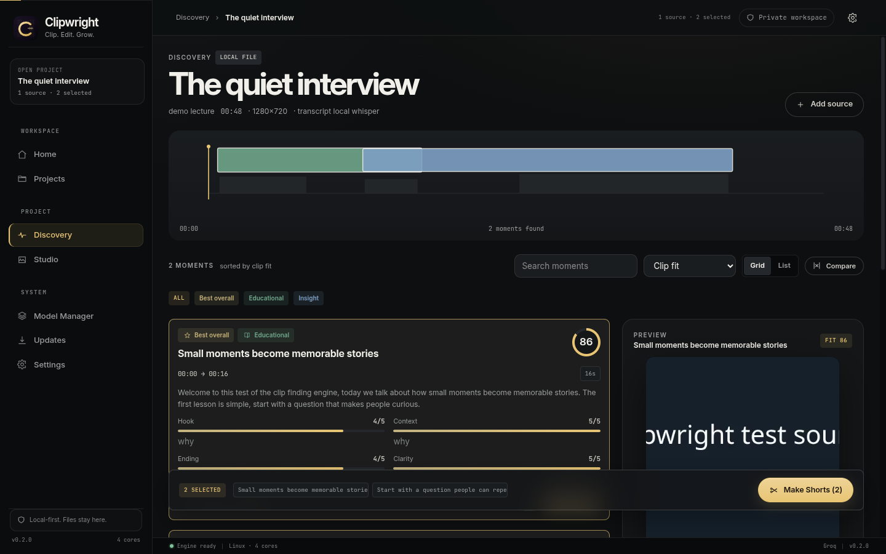

# Clipwright

**Find the moment. Make it travel.**

Clipwright is a desktop clip-discovery and Shorts production app for long conversations. It
transcribes a source, reads the whole transcript, proposes timestamped moments with evidence,
lets you compare and refine them, then renders validated 1080×1920 clips with burned-in
subtitles.



The product name lives in one place: `engine/shorts_engine/common/brand.py`. The desktop
mirror is generated by `scripts/gen-brand`.

## What works

- **Local import** of MP4/MKV/MOV/WebM/audio with ffprobe validation; **URL metadata** import
  through bundled yt-dlp + Deno (selective section retrieval is implemented but not
  end-to-end verified).
- **Transcription** with local faster-whisper (real `tiny` model verified) or an
  OpenAI-compatible cloud endpoint (control flow only; no live key available).
- **Discovery** through a BYOK provider: transcript windows, segment-ID proposals, Pydantic
  validation, sentence/word boundary snapping, IoU dedupe, deterministic Clip fit, nine
  categories, weak/strong evidence.
- **Optional on-device AI**: download Qwen3 0.6B (610 MiB GGUF) in Model Manager; a successful
  download is immediately activated as the default analysis provider. No API key and no
  transcript leaves the machine. It is slower and less nuanced than Groq; the UI says so.
- **Rate-limit-aware discovery**: adjacent transcript windows are batched (default 2, adjustable)
  and provider token counters are not double-counted, reducing needless Groq waits.
- **Update awareness**: the app asks the public GitHub release feed once at launch, shows an
  Updates tab and a dismissible banner when a newer semver exists, and links to the release
  notes and platform download. No account, token, auto-install, or background polling.
- **Discovery UI**: moment map, filters, sort, grid/list, side-by-side compare, multi-select
  tray, boundary nudge/word snap with undo revisions, live transcript highlight.
- **Studio**: fill / blur-fill / manual crop, static zoom, subtitle size/color/highlight/
  position/outline/max lines, music/ducking, presets.
- **Render**: 1080×1920 H.264 High + AAC 192k, loudnorm −14 LUFS, faststart, atomic output,
  ffprobe + decode validation.
- **Batch export and cancel**, checkpointed jobs, rate-limit waiting with resume.
- **First-launch wizard**, Model Manager with pinned/verified downloads, hardware profile,
  provider add/test/switch, safeStorage keys, diagnostics and request log.
- **Four themes** (Velvet, Ember, Ivory, Slate), dark/light, density, reduce-motion.
- **Security**: sandboxed renderer, context isolation, no Node, strict CSP, allow-listed IPC,
  trusted-frame checks, `media://` by asset ID, no shell access.

## Screenshots

| | |
| --- | --- |
| [Home](docs/screenshots/01-home-velvet.png) | [Studio](docs/screenshots/04-studio-velvet.png) |
| [Compare](docs/screenshots/03-compare-velvet.png) | [Ivory light](docs/screenshots/08-home-ivory.png) |
| [Rate-limit wait](docs/screenshots/18-rate-limit-wait.png) | [Wizard](docs/screenshots/16-wizard-welcome.png) |
| [Update available](docs/screenshots/20-updates.png) | [Model Manager](docs/screenshots/07-models.png) |

The full set (empty, error, long title, small/large windows, all themes, privacy, models) is
in [`docs/screenshots/`](docs/screenshots/). See
[`docs/DESIGN_SYSTEM.md`](docs/DESIGN_SYSTEM.md).

## Quick start (development)

```bash
python3.12 -m venv .venv
.venv/bin/pip install -e "engine[dev]"   # llama-cpp-python may compile; a C/C++ toolchain is needed if no wheel exists
./scripts/fetch-binaries          # pinned ffmpeg, ffprobe, yt-dlp, deno
./scripts/gen-brand && ./scripts/gen-schemas

cd apps/desktop
npm ci
npm run dev
```

The engine can run alone:

```bash
.venv/bin/python -m shorts_engine --stdio
```

See [`docs/ARCHITECTURE.md`](docs/ARCHITECTURE.md) and
[`docs/PROTOCOL.md`](docs/PROTOCOL.md).

## Build installers

```bash
./scripts/build-engine
cd apps/desktop
npm run dist:linux       # AppImage + .deb + linux-unpacked/
cd ../..
./scripts/verify-package
```

Current Linux artifacts and sizes are in [`docs/RELEASE.md`](docs/RELEASE.md), and the
[public v0.1.1 release](https://github.com/porkfrnd/clipwright/releases/tag/v0.1.1) has the
AppImage, `.deb` and SHA-256 sums. The packaged unpacked app completed the full local flow
with `PATH` empty (no system Python/Node/FFmpeg).

## Tests

```bash
# engine: 93 tests (1 skipped)
cd engine && ../.venv/bin/python -m pytest -q

# desktop unit/typecheck (33 unit tests)
cd ../apps/desktop && npm run typecheck && npm test

# Electron suite: long local flow, cloud rate-limit wait, update checker
npx playwright test

# the long local flow against the packaged app, with no system tools on PATH
CLIPWRIGHT_E2E_EXECUTABLE="$PWD/release/linux-unpacked/clipwright" \
CLIPWRIGHT_E2E_EMPTY_PATH=1 npx playwright test tests/ui.spec.ts
```

The AI discovery tests use a **local OpenAI-compatible stub** because no Groq key was
available. A stub is not evidence that the real provider pipeline works; live tests are marked
NOT RUN. See [`docs/DEVLOG.md`](docs/DEVLOG.md) and
[`docs/KNOWN_ISSUES.md`](docs/KNOWN_ISSUES.md).

## Benchmarks (this laptop, CPU only)

| Task | Content | Result |
| --- | --- | --- |
| Local Whisper tiny | 13 s speech | 8.7 s (1.49× real-time), 447 MB |
| Render 1080×1920 | 15.8 s clip | 18.0 s (0.88× real-time), 722 MB |

Full method and caveats: [`docs/BENCHMARKS.md`](docs/BENCHMARKS.md).

## Troubleshooting

**“The media engine could not start”** — use **Restart engine** on the screen (new builds
include this). If it still fails, open `~/.config/Clipwright/logs/main.log` and
`~/.config/Clipwright/logs/engine-stderr.log`, or run the app from a terminal to see stderr.
The engine log is also shown under the failure message.

**AppImage says “Cannot mount … FUSE setup”** — run
`APPIMAGE_EXTRACT_AND_RUN=1 ./Clipwright-0.1.1-x86_64.AppImage`, or use the `.deb` /
`release/linux-unpacked/clipwright`. This affects the AppImage runtime, not Clipwright's data.

**First URL preview or transcription feels slow** — the first preview downloads only the
selected section and is then cached; existing captions are reused before running Whisper. A
626 s YouTube source imported from its existing captions in ~52 s in the packaged build. Local
Whisper on this CPU is roughly real-time, so cloud transcription or a smaller model is faster.
Downloaded render sections are also cached by exact range. Transcripts are written in one
database transaction, repeated transcription reuses prepared audio, and Project loads segment
text without word rows (words load only when Studio or boundary snapping needs them).

**A URL preview fails** — Clipwright retries with fresh extraction and alternate YouTube
clients, and reuses already-downloaded previews. If a video asks for sign-in, open
**Settings → Downloads → YouTube cookies** and choose a Netscape-format `cookies.txt` exported
from a browser where you are signed in. Otherwise update the downloader, confirm the link is
authorized, or import the local file.

## Honest status

- **Live Groq/cloud AI: NOT RUN** — no API key. The UI and control flow are verified with a
  labeled stub.
- **Local Qwen3 0.6B: runtime verified, quality not benchmarked** — a real GGUF loaded and
  answered a JSON probe in the frozen engine; local clip-selection quality is below a larger
  cloud model by design.
- **Groq rate limits: live behavior NOT RUN** — token accounting and batching are tested with
  a stub; no Groq key was available to confirm the plan’s exact limits.
- **Windows: not built/tested.** Linux AppImage/`.deb` only.
- **Face tracking: not implemented** — static center crop / blur fit.
- **Cloud transcription: not tested live.**
- **Hardware encoding: unavailable on the build machine** — software libx264 verified.
- **Update checks: the GitHub path is unit-tested with a local API stub and live-tested against
  the published v0.1.1 release** — 0.1.1 reports itself current. The next tagged release is what
  proves the end-to-end notification in a previously installed build.
- **FFmpeg is GPL-2.0-or-later**; commercial redistribution needs legal review.

Full list: [`docs/KNOWN_ISSUES.md`](docs/KNOWN_ISSUES.md).

## Documentation

- [Architecture](docs/ARCHITECTURE.md)
- [Protocol](docs/PROTOCOL.md)
- [Design system](docs/DESIGN_SYSTEM.md)
- [Decisions](docs/DECISIONS.md)
- [Known issues](docs/KNOWN_ISSUES.md)
- [Release](docs/RELEASE.md)
- [Benchmarks](docs/BENCHMARKS.md)
- [Development log](docs/DEVLOG.md)
- [Third-party licenses](THIRD_PARTY_LICENSES.md)

## License

Clipwright is MIT (`LICENSE`). Bundled tools and models have their own licenses; read
[`THIRD_PARTY_LICENSES.md`](THIRD_PARTY_LICENSES.md), especially the FFmpeg GPL notice.
